<div align="center">


<br>


<p><i>An undergraduate thesis project · BSc Management Information Systems · NSBM Green University · 2026</i></p>

<p>
<a href="#-the-30-second-version"><b>30-second version</b></a> ·
<a href="#-how-the-study-works">How it works</a> ·
<a href="#-results">Results</a> ·
<a href="#-which-features-survive">Features</a> ·
<a href="#-extension-human-vs-ai-vs-ai-paraphrased">Extension</a> ·
<a href="#-try-it-yourself">Try it</a> ·
<a href="#-limitations-and-responsible-use">Limitations</a>
</p>

</div>

---

> **The question.** Four AI labs trained models that write fluent English. Remove the branding and hand someone a paragraph of plain text: *can you still tell which model wrote it?* And if a second AI then rewrites that paragraph to hide its tracks, *does the fingerprint survive?*

This repository holds the code, data, trained models, results and live demo behind the thesis **"Which Model Leaves the Last Fingerprint? Stylometric Attribution Survival Under LLM-Based Rewriting Pressure"**. It aims to be honest about the answer even where the answer is "partly".

## ⚡ The 30-second version

<table>
<tr>
<td align="center" width="25%"><h3>761</h3>verified passages<br><sub>of 1,196 collected</sub></td>
<td align="center" width="25%"><h3>4</h3>models compared<br><sub>ChatGPT · Claude · Gemini · Grok</sub></td>
<td align="center" width="25%"><h3>0.706 → 0.402</h3>macro F1 after<br><sub>heavy rewriting</sub></td>
<td align="center" width="25%"><h3>0.25</h3>chance level<br><sub>(4 classes)</sub></td>
</tr>
</table>

**Rewriting weakens the fingerprint but does not erase it.** A classifier trained only on *original* text identifies the source model well above chance even after a second AI has rewritten about two thirds of the words, and the loss is uneven across models and features.

| | Question (thesis §1.4) | Short answer |
|:--|:--|:--|
| **Main** | How do LLM stylometric fingerprints survive rewriting pressure, and which attribution features resist erasure across ChatGPT, Claude, Gemini, and Grok under LLM-based rewriting at light and heavy intensity levels? | They weaken but persist. Some features resist far better than others (see RQ3). |
| **RQ1** | Baseline accuracy before any rewriting? | Macro F1 **0.706**, against 0.25 for guessing (2.8×). |
| **RQ2** | How far does it fall under light (≈ 40% edit) and heavy (≈ 65% edit) rewriting? | **0.530** (−25%) and **0.402** (−43%). Still 2.1× and 1.6× chance. |
| **RQ3** | Which features keep their power, and does semantic signal survive like stylometric signal? | Comma density keeps 124% of its importance; the strongest feature, type-token ratio, keeps only 77%. Semantic importance holds (103%), but a semantic-only classifier is weak to begin with (0.354). |
| **RQ4** | Does combining feature types beat either alone? | Barely. At baseline, combined XGBoost scores 0.694 against 0.681 for stylometric-only. Under rewriting, stylometric-only is nominally ahead. |

## 🧪 How the study works

<p align="center">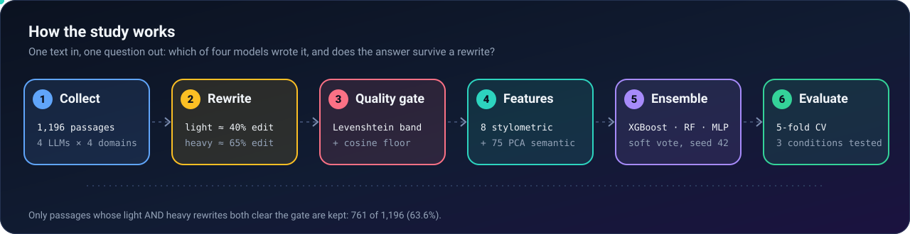</p>

| Step | What happens | Why it matters |
|:--|:--|:--|
| **1 · Collect** | 1,196 AI-written passages: ChatGPT 300, Claude 300, Gemini 299, Grok 297, spread over four domains (abstracts, books, news, Reddit). Text comes from the RAID benchmark and direct API collection. | RAID has no Grok text, so a benchmark alone could not answer the question. |
| **2 · Rewrite** | Every passage is rewritten twice by GPT-OSS-120B: *light* (≈ 40% of words changed) and *heavy* (≈ 65%). | The rewriter is a different model from the four being identified. |
| **3 · Quality gate** | A rewrite is kept only if it passes **two** checks: a Levenshtein band (light 0.30–0.50, heavy 0.55–0.70) proving it really changed the text, and a cosine-similarity floor on sentence embeddings (light ≥ 0.80, heavy ≥ 0.597) proving it kept the meaning. | An LLM told to "change 40%" rarely hits 40% or keeps the meaning. Checking both stops weak or drifting rewrites from polluting the test. **761 of 1,196 (63.6%)** passages pass for both light and heavy. |
| **4 · Features** | 8 stylometric features plus an `all-MiniLM-L6-v2` sentence embedding reduced to 75 PCA components, 83 features in total. | Style (how it is written) and semantics (what it says) are measured separately so their roles can be compared. |
| **5 · Ensemble** | Soft-voting ensemble of XGBoost, Random Forest and a small MLP. Fixed hyperparameters, seed 42. | One transparent recipe, so differences come from the data and not from tuning. |
| **6 · Evaluate** | 5-fold stratified cross-validation. Trained on **original text only**, then tested on the original, light and heavy versions of the held-out passages, with no retraining. | This is the "rewriting pressure" test: how much of the learned fingerprint is still readable after a rewrite? |

<details>
<summary><b>The 8 stylometric features</b></summary>

<br>

Mean sentence length · sentence-length variance · type-token ratio (vocabulary variety) · hedging frequency · passive-voice rate · comma density · mean word length · Flesch–Kincaid grade.

</details>

## 📉 Results

<p align="center"></p>

**How to read it.** *Macro F1* averages the per-model F1 scores so that no model counts for more than another. 1.0 would be perfect and 0.25 is what random guessing gives with four models.

### Where does the signal go? Confusion matrices (fold 1)

<table>
<tr>
<td width="33%">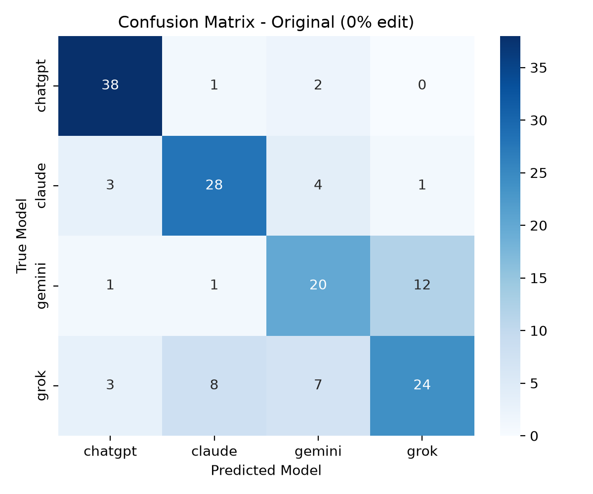</td>
<td width="33%">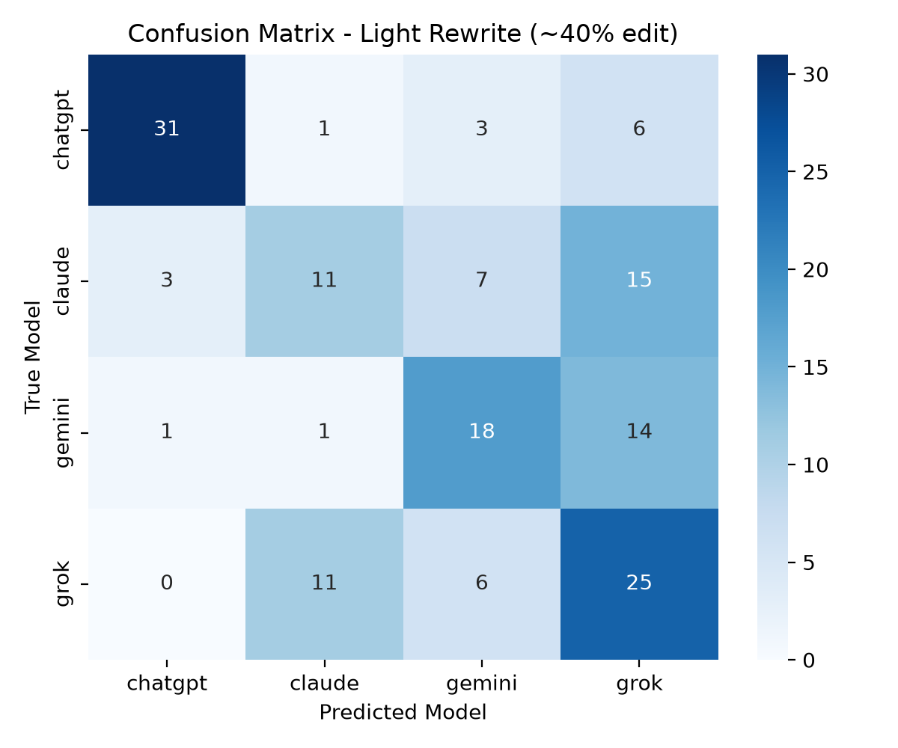</td>
<td width="33%">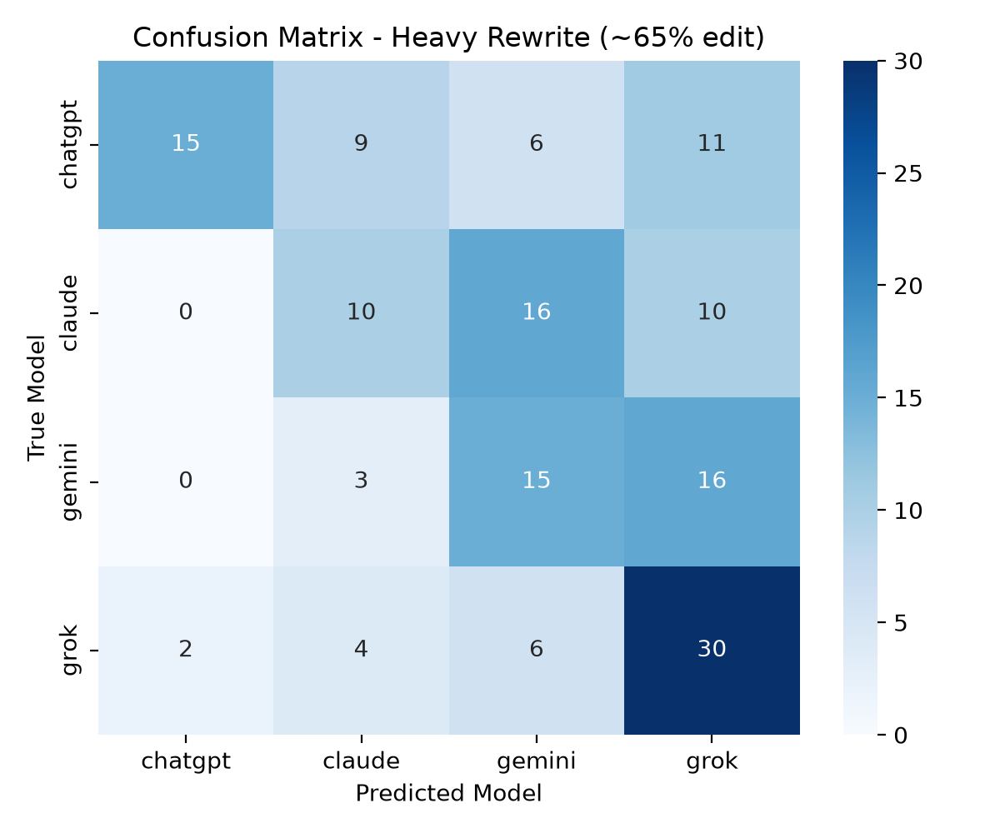</td>
</tr>
<tr>
<td align="center"><sub>Original text</sub></td>
<td align="center"><sub>Light rewrite (≈ 40% edit)</sub></td>
<td align="center"><sub>Heavy rewrite (≈ 65% edit)</sub></td>
</tr>
</table>

<p align="center"></p>

The damage is **not uniform**. ChatGPT's text is the easiest to recognise at first and loses the most under a heavy rewrite; Claude ends up lowest. Grok's recall rises, but that is a side effect: heavy rewriting pushes many predictions towards Grok, so only 45% of the passages *labelled* Grok really are (65% before).

<details>
<summary><b>Per-fold scores (macro F1)</b></summary>

<br>

| Fold | Original | Light rewrite | Heavy rewrite |
|:-:|:-:|:-:|:-:|
| 1 | 0.7113 | 0.5505 | 0.4450 |
| 2 | 0.6677 | 0.4940 | 0.3751 |
| 3 | 0.7183 | 0.5620 | 0.3957 |
| 4 | 0.7374 | 0.5303 | 0.3961 |
| 5 | 0.6960 | 0.5136 | 0.3969 |
| **Mean ± SD** | **0.7061 ± 0.0234** | **0.5301 ± 0.0245** | **0.4017 ± 0.0231** |

Fold 1 is the fold used for the confusion matrices and SHAP analysis. It also has the highest heavy-rewrite score of the five folds, so the per-model figures above may be somewhat optimistic for an average fold.

</details>

<details>
<summary><b>Ablation: which feature types matter? (macro F1)</b></summary>

<br>

| Configuration | Original | Light | Heavy |
|:--|:-:|:-:|:-:|
| Stylometric only (XGBoost) | 0.681 | 0.542 | 0.446 |
| Semantic only (XGBoost) | 0.354 | 0.271 | 0.238 |
| Combined (XGBoost) | 0.694 | 0.526 | 0.431 |
| **Combined, soft-voting ensemble (primary)** | **0.706** | **0.530** | **0.402** |
| Chance | 0.250 | 0.250 | 0.250 |

Style carries the attribution signal. Meaning on its own is only modestly above chance on original text and at chance after a heavy rewrite, which makes sense because a rewrite is built to keep the meaning. Under heavy rewriting the stylometric-only model scores nominally higher than the full ensemble.

</details>

## 🔍 Which features survive

<p align="center"></p>

<p align="center">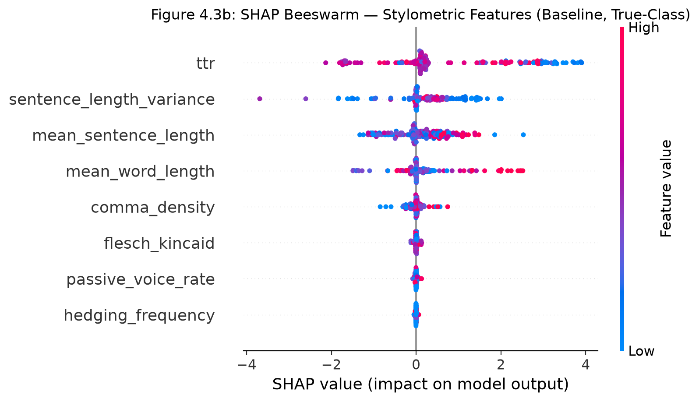</p>

**How to read it.** SHAP says how much each feature pushes a prediction. *Survival* compares a feature's importance on heavily rewritten text with its importance on original text (100% means unchanged).

- **Type-token ratio** is the most informative feature on original text, and the most fragile (77% kept). Probably because a rewriter readily swaps vocabulary.
- **Comma density** starts only 5th of 8 but keeps 124%. Rewriting seems to leave punctuation habits alone.
- No clean "structure survives, vocabulary does not" rule emerges: sentence-length variance is also fragile (87%) while hedging frequency holds up (119%).
- Very weak features, such as hedging frequency (baseline importance 0.010), can swing by large percentages from tiny numbers, so treat their survival figures with care.

> SHAP is computed on the XGBoost member of the ensemble using fold 1, restricted to each passage's true class.

## 🧩 Extension: human vs AI vs AI-paraphrased

The core study never needed human writing: every passage is AI-generated. The extension asks a different, exploratory question: **is a text human-written, AI-generated, or AI-generated and then paraphrased by another model?** It reuses the same features and ensemble recipe, with its own data and its own five saved fold models.

<p align="center"></p>

- **Result:** macro F1 **0.693** (±0.020, chance 0.333) over 1,620 passages. On fold 1, 61 of 72 human passages were found (precision 0.94) and only 1 of 126 paraphrased passages was called human. The two AI classes, however, are often confused with each other.
- **Human data (360 passages, 90 per domain):** public sources matched to the same four domains.

  | Domain | Source |
  |:--|:--|
  | Abstracts | [ArXivAbsTitleDataset](https://github.com/gcunhase/ArXivAbsTitleDataset), real arXiv abstracts |
  | Books | NLTK Gutenberg corpus (public-domain fiction), cut into paragraph-based excerpts |
  | News | NLTK Reuters corpus (1980s newswire) |
  | Reddit | [Reddit-dataset-samples](https://github.com/luminati-io/Reddit-dataset-samples), English posts only |

  Every row of `human_samples.csv` records its exact origin in a `source` column.
- **Balancing:** the two AI classes are much larger than the human class (761 and 1,522 passages), so each is sampled down to 630, which is 1.75 times the human count, stratified by domain and model.
- **PCA size:** recomputed for this task (120 components, about 83% of the variance, 10.1 training samples per feature) instead of reusing the 75 from the main study.

> **Read this before trusting it.** The human texts differ from the AI texts in more than authorship: the fiction was written before 1915, the news is from the 1980s, and nothing guarantees every Reddit post was written by a person. The classifier may partly separate older writing from newer writing. It is a demonstration, not a validated detector.

## 🚀 Try it yourself

<table>
<tr>
<td width="50%">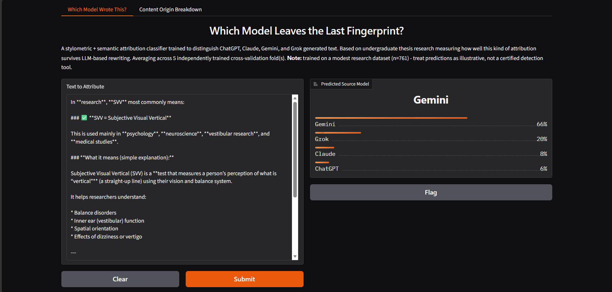</td>
<td width="50%">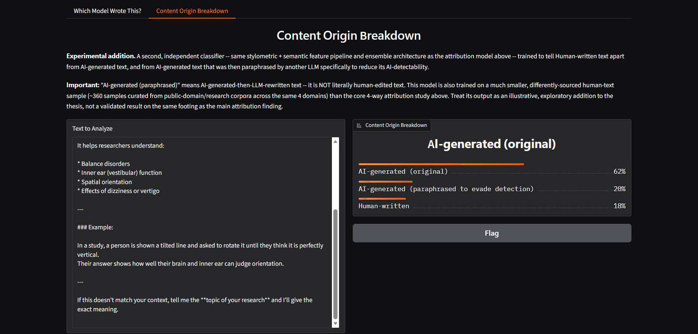</td>
</tr>
<tr>
<td align="center"><sub><b>Which Model Wrote This?</b> four-way attribution</sub></td>
<td align="center"><sub><b>Content Origin Breakdown</b> human / AI / paraphrased (experimental)</sub></td>
</tr>
</table>

```bash
git clone https://github.com/harshadulshan/llm-model-attribution-thesis.git
cd llm-model-attribution-thesis

pip install -r requirements.txt
python -m spacy download en_core_web_sm

python app.py        # opens a local Gradio app, usually at http://127.0.0.1:7860
```

Paste a few sentences and each tab returns class probabilities averaged over the five independently trained fold models. The first run downloads the `all-MiniLM-L6-v2` embedding model (about 90 MB).

> The percentages are the model's confidence about the **whole passage**. They do **not** measure how much of the text came from each source.

The trained models are Python pickle files (`fold*_pipeline.pkl`, `human_fold*_pipeline.pkl`). Only load pickle files from sources you trust, and keep this repository's files next to `app.py`.

## 🔁 Reproduce the results

```mermaid
flowchart LR
    A[("master_clean_originals.csv<br/>1,196 AI passages")] --> B["LLM rewriting<br/>(script not included)"]
    B --> C[("master_rewritten_samples_v2.csv<br/>(not included)")]
    C --> D["compute_cosine_gate.py"]
    D --> E[("master_rewritten_samples_FINAL.csv")]
    E --> F["extract_features.py"]
    F --> G[("features_extracted.csv")]
    G --> H["extract_embeddings.py"]
    H --> I[("semantic_embeddings.npy")]
    G --> J["train_all_folds.py"]
    I --> J
    J --> K[("fold1-5_pipeline.pkl")]
    G --> L["ablation_study_v2.py"]
    K --> M["shap_analysis_v3.py<br/>confusion_matrices.py"]
    classDef data fill:#0f766e,stroke:#2dd4bf,color:#fff;
    classDef missing fill:#3f3f46,stroke:#a1a1aa,color:#e4e4e7,stroke-dasharray: 4 3;
    class A,E,G,I,K data;
    class B,C missing;
```

Everything from `features_extracted.csv` onwards can be re-run from this repository:

```bash
python verify_alignment.py        # sanity check: original / light / heavy rows line up
python train_all_folds.py         # 5-fold training, writes fold1-5_pipeline.pkl
python ablation_study_v2.py       # feature-type ablation
python shap_analysis_v3.py        # SHAP survival (needs the fold 1 pipeline and `pip install shap`)
python confusion_matrices.py      # confusion matrices (needs `pip install matplotlib seaborn`)
```

**Exact numbers need the pinned versions** (Python 3.12, `requirements.txt`). As a check, a re-run of `train_all_folds.py` on different library versions (scikit-learn 1.8, XGBoost 3.2, NumPy 2.4, Python 3.11) gave 0.701 / 0.523 / 0.402 for original / light / heavy, within about 0.007 of the reported 0.706 / 0.530 / 0.402. The seed is fixed at 42.

The rewriting step itself (the call to GPT-OSS-120B) and the raw human corpora used by `build_human_dataset.py` are not included; their outputs (`master_rewritten_samples_FINAL.csv`, `human_samples.csv`) are.

## 📁 Repository map

```text
.
├── app.py                              Gradio demo with two tabs
├── requirements.txt
├── docs/                               animated figures and demo screenshots used in this README
│
├── master_clean_originals.csv          1,196 AI-written source passages
├── master_rewritten_samples_FINAL.csv  light and heavy rewrites, with gate scores and pass flags
├── features_extracted.csv              8 stylometric features for the 761 verified passages × 3 conditions
├── semantic_embeddings.npy             384-dimension MiniLM embeddings for the same rows
│
├── compute_cosine_gate.py              cosine-similarity half of the quality gate
├── generate_full_rewrites.py           near-identical variant of the gate script
├── extract_features.py                 stylometric features
├── extract_embeddings.py               semantic embeddings
├── train_all_folds.py                  5-fold training, saves all five pipelines (used by app.py)
├── train_classifier_v2.py              earlier version that saves fold 1 only
├── ablation_study_v2.py                stylometric-only / semantic-only / combined
├── shap_analysis_v3.py                 SHAP feature-survival analysis
├── confusion_matrices.py               confusion matrices for original / light / heavy
├── verify_alignment.py                 data-integrity check
├── fold1_pipeline.pkl … fold5_pipeline.pkl
├── *_FINAL.csv, confusion_*.csv/png    results and figures from the analyses above
│
│   Extension: human vs AI vs AI-paraphrased
├── build_human_dataset.py              assembles the 360 human passages
├── extract_human_stylo_features.py     stylometric features for the human passages
├── 04_build_human_capability_classifier.py   trains and evaluates the three-class model
├── human_samples.csv                   human passages with a source column
├── human_stylo_features.csv, human_embeddings.npy
├── human_fold1_pipeline.pkl … human_fold5_pipeline.pkl
└── human_*.csv/png                     ablation, confusion matrix, SHAP results
```

Earlier iterations (`train_classifier.py`, `ablation_study.py`, `shap_analysis.py`, `shap_analysis_v2.py`, `verify_shap_shape.py`) are kept as a record of the work. The files above are the final versions.

## 🚧 Limitations and responsible use

- **Scale.** 761 verified passages, four domains, four models. These are research-scale results, not a benchmark.
- **One rewriter.** All rewrites come from a single model (GPT-OSS-120B). Other paraphrasers, or a rewriter that is trying to beat this classifier, may behave differently.
- **One fold for the detail.** The confusion matrices and SHAP values come from fold 1, which is a favourable fold for heavy rewriting (see the per-fold table).
- **Domain and genre.** Findings may not carry over to other text types, other languages or other model versions.
- **Extension caveats.** Folds were not grouped by source passage, so a passage and its paraphrase can fall on opposite sides of a split. The paraphrased class covers one rewriting model, and the human sample differs from the AI text in era and genre.
- **Not a detector for people.** AI-text detectors are known to be unreliable in education and to be biased against non-native English writers. Do not use this project to accuse a student of anything.

Licences differ by part: the **code** is under the MIT licence (see `LICENSE`). The **data** keeps the terms of its original sources (RAID, NLTK corpora, arXiv abstracts, Reddit samples).

## 📚 Cite, licence, contact

```bibtex
@thesis{dulshan2026fingerprint,
  author = {Dulshan, H. P. H.},
  title  = {Which Model Leaves the Last Fingerprint? Stylometric Attribution Survival Under LLM-Based Rewriting Pressure},
  school = {NSBM Green University},
  type   = {BSc thesis},
  year   = {2026},
  note   = {Code and data: https://github.com/harshadulshan/llm-model-attribution-thesis}
}
```

GitHub's **Cite this repository** button reads `CITATION.cff`. Questions or suggestions are welcome as [issues](https://github.com/harshadulshan/llm-model-attribution-thesis/issues).

<p align="center"><sub>Built by H. P. H. Dulshan · BSc Management Information Systems (Special) · NSBM Green University, Sri Lanka</sub></p>
